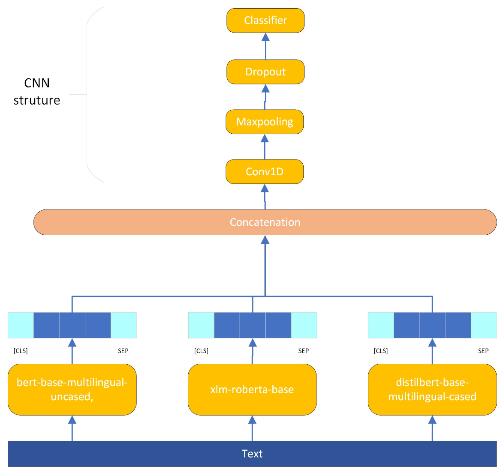

<div align="center">

# A Transparent Pipeline for Identifying Sexism in Social Media

[](https://doi.org/10.5281/zenodo.20091834)
[](https://doi.org/10.3390/app14198620)
[](LICENSE)

*BERT + SHAP + ensemble learning for transparent sexism detection in social media.*

</div>

## Paper

|                  |                                                                          |
| ---------------- | ------------------------------------------------------------------------ |
| **Title**        | A Transparent Pipeline for Online Sexism Detection Based on the Combination of Explainable Artificial Intelligence, Feature Selection, and Ensemble Learning |
| **Authors**      | Hadi Mohammadi, Anastasia Giachanou, Robert A. Bagheri |
| **Affiliation**  | Utrecht University, The Netherlands |
| **Venue**        | Applied Sciences, 14(19), 8620, 2024 |
| **DOI (paper)**  | [10.3390/app14198620](https://doi.org/10.3390/app14198620) |
| **Code archive** | [10.5281/zenodo.20091834](https://doi.org/10.5281/zenodo.20091834) (this repository, snapshot v1.0-thesis) |

> This repository accompanies **Chapter 3** of the PhD thesis
> *Let Me Explain! Explainable NLP for Understanding Large Language Models* (Hadi Mohammadi, Utrecht University, 2026).

## Abstract

Sexism detection on social media is a high-stakes content-moderation task where transparency in model decisions is essential for moderators to verify and trust the system. This work develops a transparent pipeline that combines BERT-based classification with SHAP explanations and feature selection, allowing moderators to inspect the lexical and contextual cues that drove each prediction. Evaluated on benchmark datasets, the pipeline achieves competitive accuracy while exposing the words and phrases responsible for each decision.

## Citation

If you use this code or data, please cite **both** the paper and this code archive:

```bibtex
@article{mohammadi2024explainable,
  title         = {A Transparent Pipeline for Online Sexism Detection Based on the Combination of Explainable Artificial Intelligence, Feature Selection, and Ensemble Learning},
  author        = {Mohammadi, Hadi and Giachanou, Anastasia and Bagheri, Robert A.},
  year          = {2024},
  journal       = {Applied Sciences},
  doi           = {10.3390/app14198620}
}

@software{mohammadi_explainable_sexism_detection_2026,
  author    = {Mohammadi, Hadi and Giachanou, Anastasia and Bagheri, Robert A.},
  title     = {A Transparent Pipeline for Identifying Sexism in Social Media},
  year      = {2026},
  publisher = {Zenodo},
  version   = {v1.0-thesis},
  doi       = {10.5281/zenodo.20091834},
  url       = {https://doi.org/10.5281/zenodo.20091834}
}
```

---

## Overview

This repository contains the code, notebooks, data derivatives, and figures behind the transparent sexism-detection pipeline: BERT-based classifiers on EXIST 2023/2024 tweets, SHAP token attributions (overall, per language, and per annotator demographic group), and an ensemble combining ML and DL approaches. It supports reproducing the SHAP and demographic analyses reported in the paper.

## Key Features

- **Transparent detection pipeline** with interpretable predictions
- **Analysis of linguistic patterns** associated with sexist content
- **Comparison of explanation methods** (SHAP vs LIME) for text classification
- **Human evaluation** of model explanations

<div align="center">

<br><i>Ensemble model architecture combining ML and DL approaches</i>
</div>

## Quick Start

```bash
git clone https://github.com/mohammadi-hadi/Explainable-Sexism-Detection.git
cd Explainable-Sexism-Detection

# To run the analysis notebooks
pip install pandas numpy torch transformers scikit-learn shap matplotlib seaborn
jupyter lab notebooks/
```

The paper provides full methodology and references the figures in `figures/`. SHAP token importances aggregated over the test set are in `data/significant_tokens.csv`; per-demographic-group SHAP attributions are in `data/demographic_word_importance/`.

## Repository Structure

```
Explainable-Sexism-Detection/
├── README.md
├── LICENSE
├── CITATION.cff
├── CONTRIBUTING.md
├── code/
│   └── custom_model.py                           # Multilingual BERT + XLM-R + DistilBERT ensemble
├── notebooks/
│   ├── BERT_model.ipynb                          # BERT classifier on EXIST 2023/2024
│   ├── PyTorch_BERT_training.ipynb               # PyTorch training pipeline
│   ├── EXIST2024.ipynb                           # EXIST 2024 task analysis
│   ├── EXIST_technical_report.ipynb              # Shared-task technical report notebook
│   ├── LLama_70B.ipynb                           # LLaMA-70B sexism evaluation (English)
│   └── LLama_70B_Spanish.ipynb                   # LLaMA-70B sexism evaluation (Spanish)
├── data/
│   ├── README.md                                 # What is here, and how to get the corpora
│   ├── ethics_reference.md                       # Data sources and ethics statement
│   ├── significant_tokens.csv                    # SHAP token importances
│   ├── coef_df.csv                               # Logistic-regression coefficients
│   ├── important_tokens1_es.csv                  # Top SHAP tokens (Spanish)
│   ├── important_words_general.csv               # Top SHAP words (overall)
│   ├── token_overlaps_Spanish.csv                # Token-overlap matrix across categories
│   ├── genai_results.csv                         # GenAI/GenP/GenXAI/GenPXAI scenario predictions
│   └── demographic_word_importance/              # 45 per-demographic SHAP-token CSVs
└── figures/
    ├── methodology.{png,pdf}                     # Pipeline overview
    ├── model.{png,pdf}                           # Model architecture
    ├── backtranslation.pdf                       # Back-translation augmentation diagram
    ├── histogram.pdf                             # Token-importance histogram
    ├── importance.pdf                            # Per-token importance plot
    ├── threshold.pdf                             # Decision-threshold curve
    ├── histogram_sexism_scores.pdf               # Distribution of sexism scores
    ├── selected_tokens_vs_threshold.pdf          # Token-selection vs threshold curve
    ├── cumulative_importance_general.png         # Cumulative SHAP importance
    ├── num_tokens_95_cumulative_importance.png   # Tokens needed for 95% importance
    ├── percentage_repeated_unique_tokens.png     # Repeated-vs-unique token share
    ├── repeated_unique_tokens_Spanish.png        # Spanish repeated-vs-unique tokens
    ├── repeated_unique_tokens_top_100_Spanish.png# Top-100 Spanish tokens
    ├── unique_tokens_across_categories_Spanish.png # Unique tokens per category (ES)
    └── EDA1.png … EDA6.png                       # Exploratory data analysis
```

## Data

`data/` holds the aggregate results the paper is drawn from: SHAP token importances overall, per language and per annotator demographic group. Those are word-and-score tables, and the figures and tables in the paper can be reproduced from them directly.

The EXIST and EDOS corpora themselves are **not** in this repository. Their organisers release them to registered participants under their own terms, and the files carry live account names and per-annotator demographic records. `data/README.md` lists what was removed and how to obtain it from the source; `data/ethics_reference.md` carries the ethics statement.

## Related Work

- [Exist-2023](https://github.com/mohammadi-hadi/Exist-2023) — BERT / XLM-RoBERTa / DistilBERT voting ensemble for the EXIST 2023 shared task (CLEF 2023)
- [Sexism-Detection-in-Social-Media](https://github.com/mohammadi-hadi/Sexism-Detection-in-Social-Media) — mirror of the EXIST 2023 system notebook
- [BehAv-PO](https://github.com/mohammadi-hadi/BehAv-PO) — behavioral cluster-driven multi-agent preference optimization for sexism detection (EXIST 2024)

## License

This work is licensed under [CC BY 4.0](https://creativecommons.org/licenses/by/4.0/).

That covers the code, notebooks, figures and the aggregate result files in this repository. It does not extend to the EXIST or EDOS corpora, which are not included here and remain under their organisers' terms.

## Contact

- **Hadi Mohammadi** — Utrecht University
- Website: [mohammadi.cv](https://mohammadi.cv)

## Acknowledgments

The EXIST shared-task organisers provided the underlying tweet data; please cite their papers and respect their terms of use.
